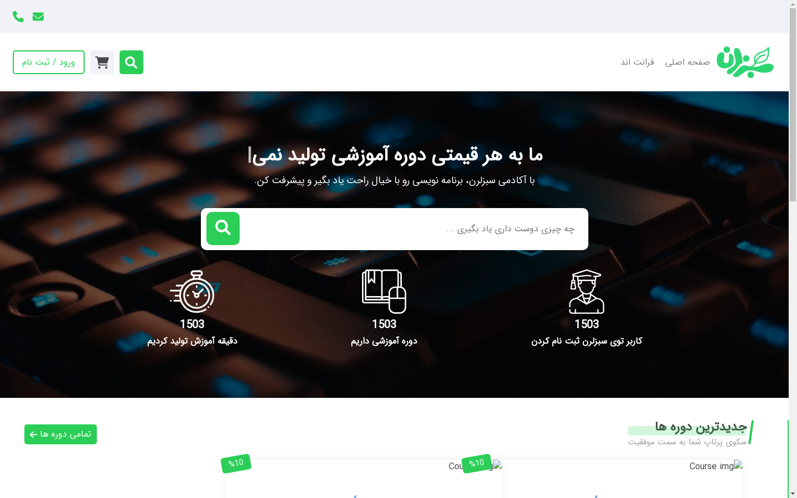
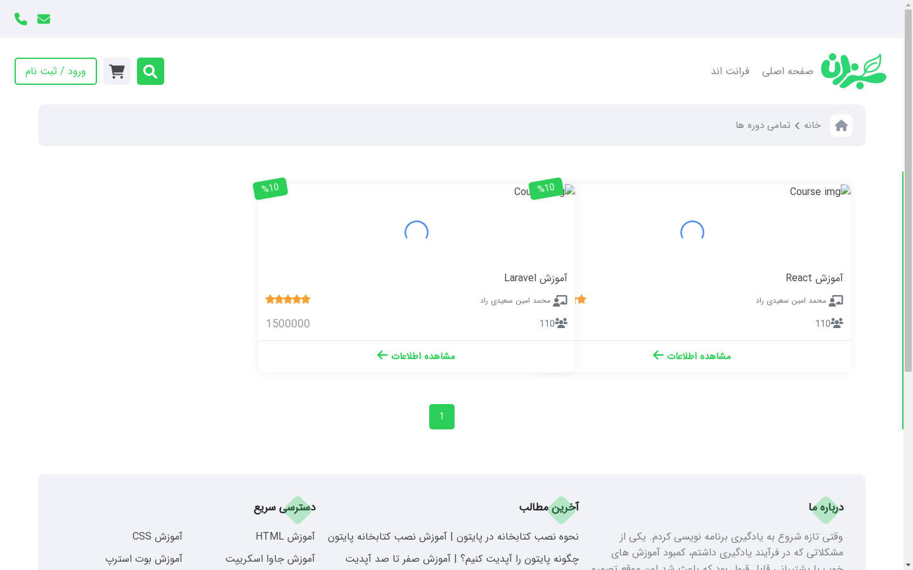
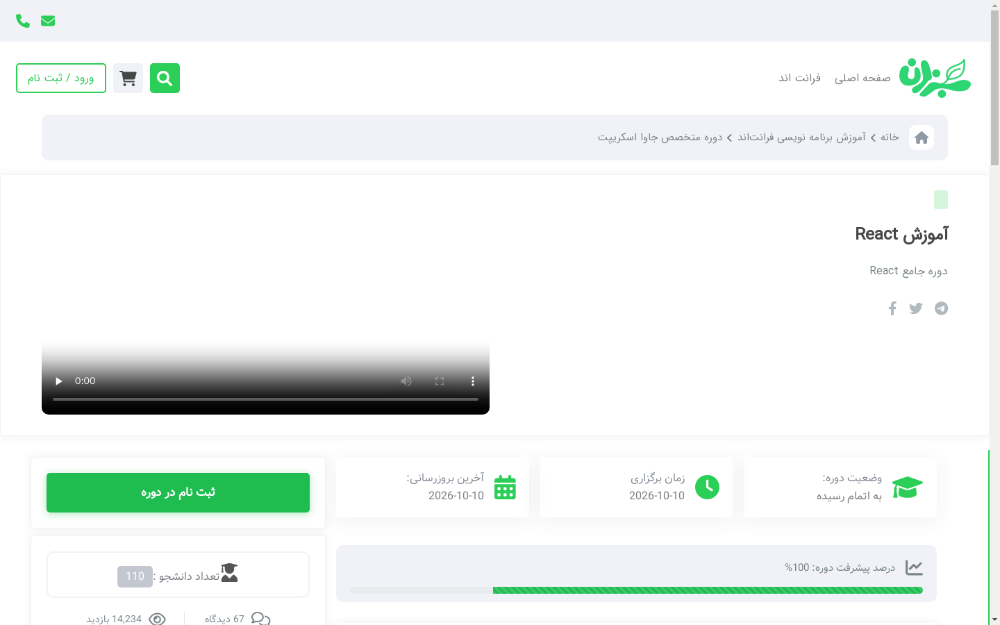
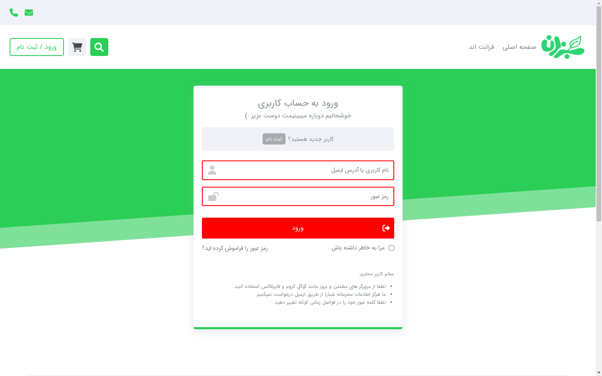
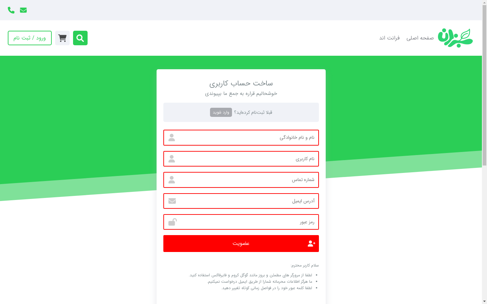
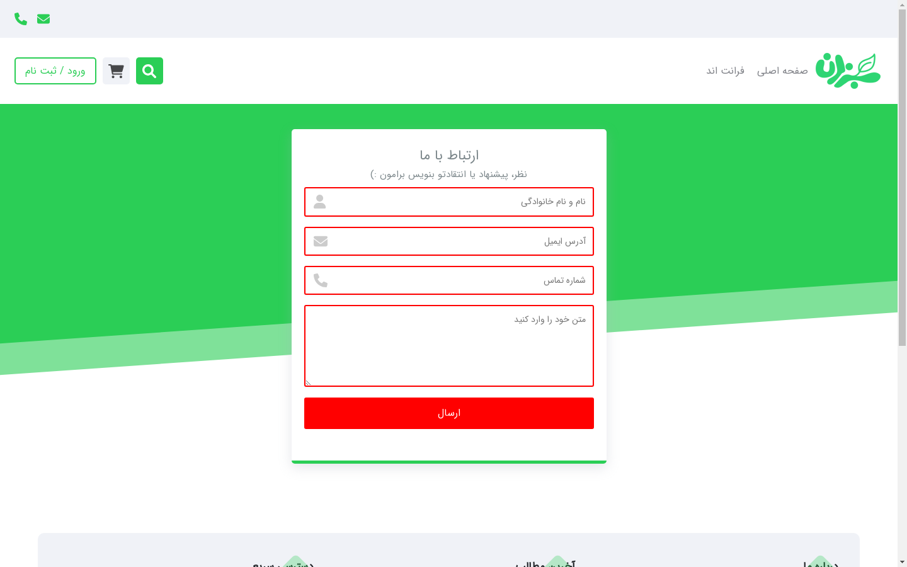
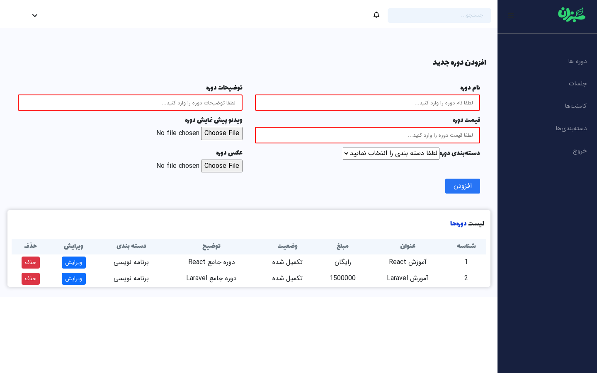
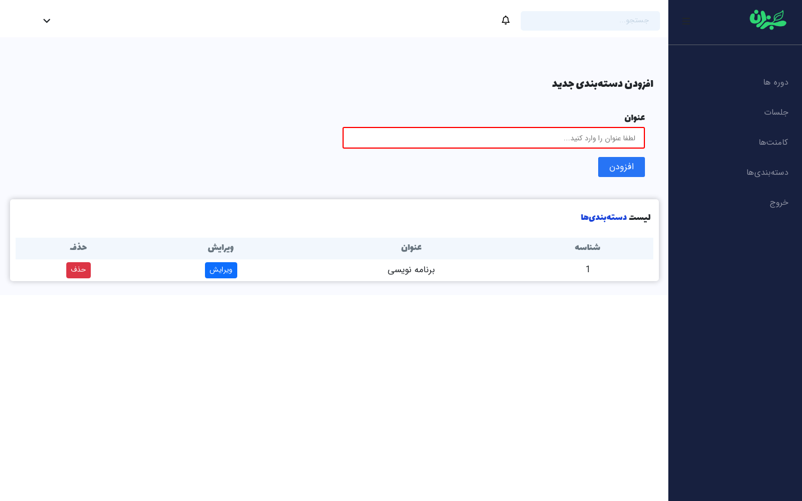
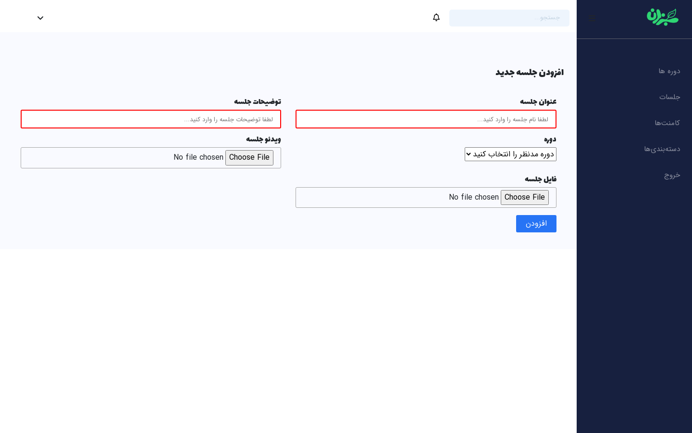
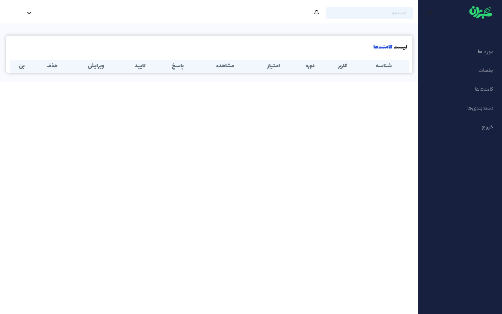

# Karlearn

Karlearn is a full-stack online learning platform (LMS) portfolio project.  
The React frontend now lives **inside this Laravel repository** and is served by Laravel as a single-page application.

**Live demo:** [https://cafejoon.ir/karlearn](https://cafejoon.ir/karlearn)

---

## Demo screenshots

### Public website

| Home | Courses |
|------|---------|
|  |  |

| Course details | Login |
|----------------|-------|
|  |  |

| Register | Contact |
|----------|---------|
|  |  |

### Admin panel (`/p-admin`)

| Courses management | Categories |
|--------------------|------------|
|  |  |

| Sessions | Comments |
|----------|----------|
|  |  |

---

## Architecture

```text
karlearn/
├── app/
│   ├── Http/Controllers/
│   │   ├── SpaController.php      # Serves the React SPA
│   │   ├── CourseController.php
│   │   └── API/...
│   ├── Models/
│   └── Filament/
├── routes/
│   ├── api.php                    # REST API (/api/*)
│   └── web.php                    # SPA catch-all + misc web routes
├── resources/
│   ├── frontend/                  # React (CRA) source
│   │   ├── public/
│   │   ├── src/
│   │   ├── package.json
│   │   ├── .env.example
│   │   └── .env.demo              # Subpath deploy example (/karlearn)
│   └── views/
│       └── spa.blade.php          # Fallback if frontend is not built
├── public/
│   └── frontend/                  # CRA production build output (generated)
└── docs/demo/                     # README screenshots
```

| Layer | Role |
|-------|------|
| Laravel API | JSON endpoints under `/api` |
| React SPA | UI for public site + `/p-admin` |
| `SpaController` | Returns `public/frontend/index.html` for non-API routes |
| Static assets | Served from `public/frontend/*` |

---

## Features

### Public site
- RTL Persian e-learning UI
- Course listing, course details, session routes
- Register / login / logout (Laravel Sanctum)
- Contact form and course search
- User account area (`/my-account`)

### Admin panel
- Course CRUD (title, description, price, category, media)
- Category management
- Session/section management
- Comments moderation UI

### Backend
- REST API for courses, categories, sections, comments, quizzes, purchases
- Sanctum token auth + Spatie permissions
- File storage for images/videos/resources
- Filament resources available in Laravel
- Iranian payment package (`dena-a/iran-payment`)

---

## Tech stack

| Layer | Technologies |
|-------|----------------|
| Backend | PHP 8.1+, Laravel 10, Sanctum, Spatie Permission, Filament 3 |
| Frontend | React 18 (CRA), React Router 6, Axios, Bootstrap 5 |
| Database | MySQL |
| Auth | Bearer tokens (Sanctum) |

---

## Demo links

| Page | URL |
|------|-----|
| Home | https://cafejoon.ir/karlearn |
| Courses | https://cafejoon.ir/karlearn/courses/1 |
| Login | https://cafejoon.ir/karlearn/login |
| Register | https://cafejoon.ir/karlearn/register |
| Contact | https://cafejoon.ir/karlearn/contact |
| Admin panel | https://cafejoon.ir/karlearn/p-admin |

---

## Local setup

### 1) Backend

```bash
cp .env.example .env
composer install
php artisan key:generate
php artisan migrate
php artisan storage:link
php artisan serve
```

API: `http://127.0.0.1:8000/api`

### 2) Frontend (inside Laravel)

```bash
# from project root
npm run frontend:install
cp resources/frontend/.env.example resources/frontend/.env
npm run frontend:build
php artisan serve
```

Then open `http://127.0.0.1:8000` — Laravel serves the SPA via `SpaController`.

### Frontend development mode

```bash
npm run frontend:dev
```

CRA runs on port `3006`. Point `REACT_APP_API_BASE` to your Laravel API (for example `http://127.0.0.1:8000/api`).

### Useful npm scripts (project root)

| Script | Description |
|--------|-------------|
| `npm run frontend:install` | Install React dependencies |
| `npm run frontend:dev` | Start CRA dev server |
| `npm run frontend:build` | Build SPA into `public/frontend` |

---

## Frontend configuration

Configured in `resources/frontend/.env`:

| Variable | Default | Purpose |
|----------|---------|---------|
| `REACT_APP_BASENAME` | _(empty)_ | React Router basename |
| `REACT_APP_API_BASE` | `/api` | API prefix used by `apiUrl()` |
| `REACT_APP_ASSET_BASE` | _(empty)_ | Media/public asset prefix |
| `PUBLIC_URL` | `/frontend` | CRA asset public path |

For a subpath deploy like `/karlearn`, use `resources/frontend/.env.demo` as a template:

```env
REACT_APP_BASENAME=/karlearn
REACT_APP_API_BASE=/karlearn/api
REACT_APP_ASSET_BASE=/karlearn
PUBLIC_URL=/karlearn/frontend
```

Shared helpers live in `resources/frontend/src/config.js`.

---

## Important API endpoints

| Method | Endpoint | Description |
|--------|----------|-------------|
| `POST` | `/api/register` | Create account |
| `POST` | `/api/login` | Login + token |
| `POST` | `/api/logout` | Logout |
| `GET` | `/api/courses` | Paginated courses |
| `GET` | `/api/courses/{id}` | Course details |
| `GET` | `/api/courses/category/{name}` | Courses by category |
| `POST` | `/api/courses/search` | Search courses |
| `GET/POST` | `/api/categories` | List / create categories |
| `POST` | `/api/sections` | Create session/section |
| `GET` | `/api/sections/{id}/stream` | Stream video |
| `GET` | `/api/comments/get/{course}` | Course comments |
| `POST` | `/api/buy` | Purchase course (auth) |
| `GET` | `/api/users/get` | Current user (auth) |
| `GET` | `/api/users/courses` | Purchased courses (auth) |

---

## Notes

- This project is a **portfolio / demo** LMS.
- The React app previously lived in a sibling `frontKarlearn` folder; it is now integrated under `resources/frontend`.
- Run `npm run frontend:build` before deploying so `public/frontend` exists.
- Some legacy admin modules still reference unfinished endpoints; core courses, categories, sessions, auth, and public browsing are the main demo focus.

---

## License

MIT
